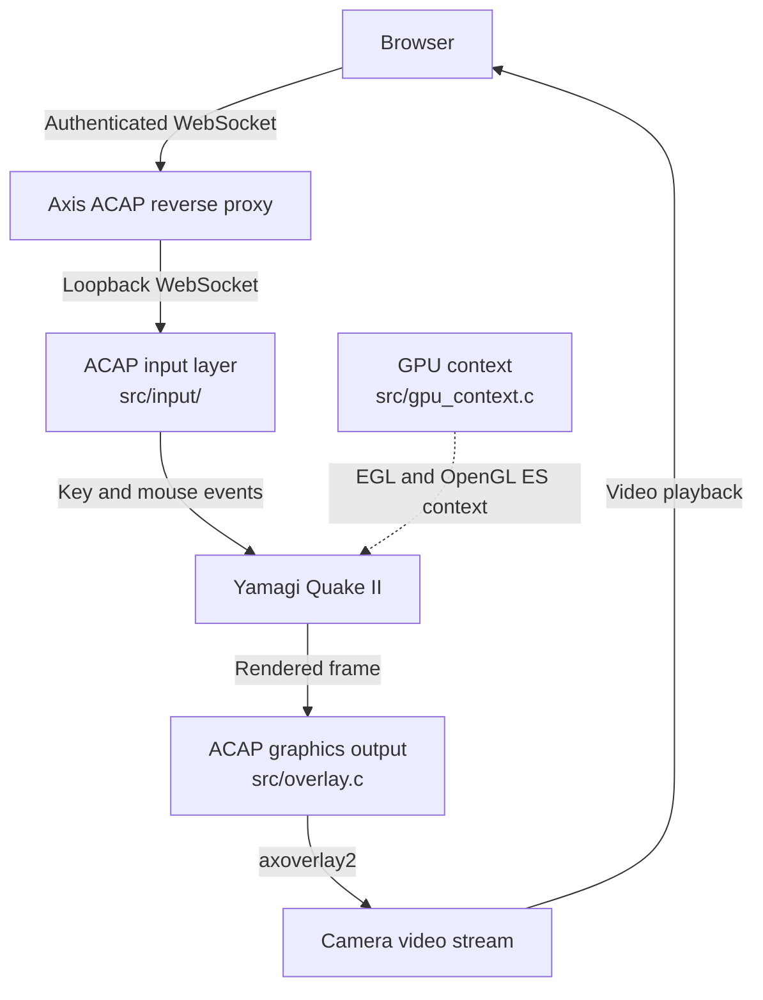
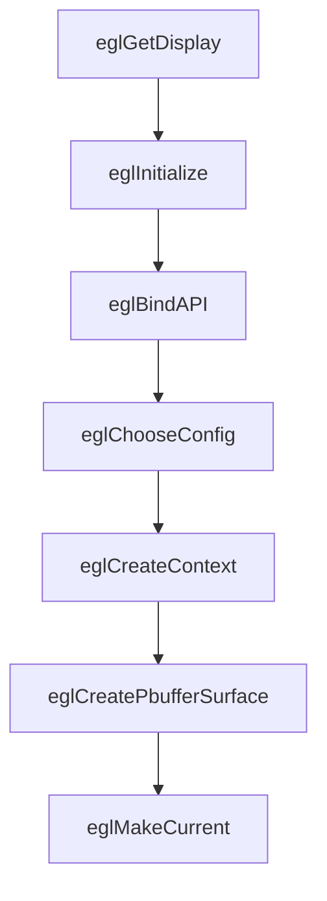
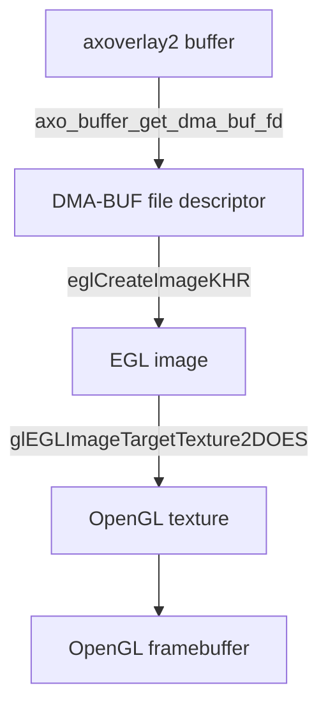
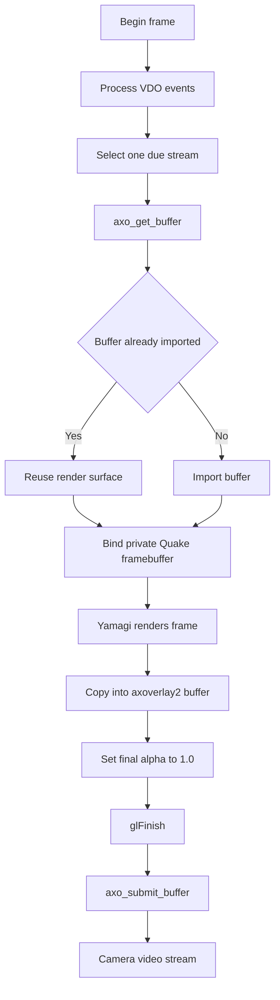
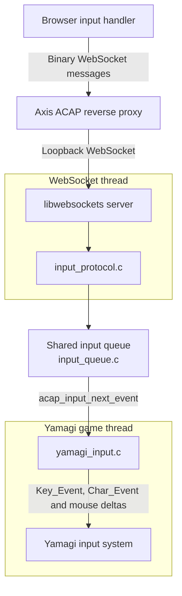

# ACAP Quake II Architecture

## Table of contents

- [ACAP Quake II Architecture](#acap-quake-ii-architecture)
  - [Table of contents](#table-of-contents)
  - [Purpose](#purpose)
  - [1. High-level architecture](#1-high-level-architecture)
    - [Browser video playback](#browser-video-playback)
  - [2. Yamagi integration](#2-yamagi-integration)
    - [Renderer hooks](#renderer-hooks)
  - [3. Graphics context](#3-graphics-context)
  - [4. Video stream and overlay setup](#4-video-stream-and-overlay-setup)
    - [Overlay creation](#overlay-creation)
    - [Render size](#render-size)
  - [5. Private Quake framebuffer](#5-private-quake-framebuffer)
  - [6. Importing axoverlay2 buffers](#6-importing-axoverlay2-buffers)
  - [7. Frame lifecycle](#7-frame-lifecycle)
    - [Beginning the frame](#beginning-the-frame)
    - [Completing the frame](#completing-the-frame)
    - [Final alpha](#final-alpha)
    - [Synchronization](#synchronization)
    - [Stream selection](#stream-selection)
  - [8. Input architecture](#8-input-architecture)
    - [Browser input handler](#browser-input-handler)
    - [WebSocket server](#websocket-server)
    - [Protocol decoder](#protocol-decoder)
      - [Wire format](#wire-format)
    - [Input queue](#input-queue)
    - [Yamagi input adapter](#yamagi-input-adapter)
  - [9. Runtime setup and audio](#9-runtime-setup-and-audio)
  - [10. Resource and thread ownership](#10-resource-and-thread-ownership)
  - [11. Where to look when debugging](#11-where-to-look-when-debugging)
  - [12. Recommended reading order](#12-recommended-reading-order)

## Purpose

ACAP (AXIS Camera Application Platform) lets applications run on Axis devices.
This guide follows browser controls into Quake II and rendered game frames back to the browser.

Start with the overview below. For rendering details, continue through sections 2 to 7.
For the control connection, jump to [Input architecture](#8-input-architecture).
The [reading order](#12-recommended-reading-order) points to the implementation when you want to explore the code.

Related documentation:

- [BUILD.md](BUILD.md) covers build, packaging, and target-side development.
- [THIRD_PARTY_DATA.md](THIRD_PARTY_DATA.md) explains where the packaged demo data comes from.

Yamagi Quake II remains the game engine.
It provides the game loop, game logic, input handling, audio handling, and GLES3 renderer.

The ACAP-specific code adapts the parts that do not map directly to the camera environment.
It provides an EGL and OpenGL ES context without a desktop window.
It sends rendered frames to a camera video stream through axoverlay2.
It receives keyboard and mouse input from the browser through the Axis ACAP WebSocket reverse proxy.

The port keeps these platform-specific changes outside Yamagi where practical.
The Yamagi patch contains the integration points that connect the engine to the ACAP-specific code.

## 1. High-level architecture

There are four main parts:

1. The browser plays the camera video stream and captures keyboard and mouse input.
2. The ACAP input layer receives browser input and converts it to events Yamagi understands.
3. Yamagi Quake II runs the game and renders each frame.
4. The ACAP graphics layer provides the GPU context and sends completed frames to the camera video stream.



[`gpu_context.c`](../src/gpu_context.c) sets up the graphics context before rendering starts.
[`overlay.c`](../src/overlay.c) manages the output buffers and submits completed frames to the video stream.

### Browser video playback

The Axis device serves the camera video stream containing the Quake overlay to the browser.
[`VideoPlayer.tsx`](../web/src/components/VideoPlayer.tsx) creates the player using the current page's host
and the saved video parameters. It passes these settings to
[`CustomPlayer.tsx`](../web/src/components/player/CustomPlayer.tsx), which uses `PlaybackArea`
from `media-stream-player` to display the stream.

Video playback and game input use separate connections.
The browser sends controls through the ACAP `input` WebSocket endpoint
while the player receives the camera video stream.

## 2. Yamagi integration

The ACAP changes to Yamagi are stored in [yquake2-acap.patch](../patches/yquake2-acap.patch).
The client executable runs the game.
`ref_gles3.so` is the renderer library it loads.

The patch performs these main tasks:

1. Links the ACAP input objects into the Quake client.
2. Links `gpu_context.o` and `overlay.o` into `ref_gles3.so`.
3. Replaces SDL OpenGL context creation with `gpu_context_init()` for ACAP builds.
4. Redirects final framebuffer handling and frame presentation to `overlay.c`.
5. Starts and stops the ACAP input system from Yamagi's normal input lifecycle.
6. Adds ACAP-specific runtime defaults during startup.

The patch does not replace the Yamagi renderer.
It changes how the renderer obtains its graphics context and where its completed frame is presented.

### Renderer hooks

A framebuffer tells OpenGL which images to draw into.
The private Quake framebuffer holds the finished game image before it is copied into an overlay buffer.

The patch adds `GL3_BeginOutputFrame()`.
On ACAP it calls `overlay_context_begin_frame()`.

The patch also adds `GL3_BindOutputFramebuffer()`.
On ACAP it calls `overlay_context_bind_frame()`.
When the shared Quake framebuffer exists, that function binds the private framebuffer owned by `overlay.c`.
Otherwise it binds framebuffer 0, the default framebuffer provided by the EGL surface.
A normal desktop build uses framebuffer 0 for the window.

Yamagi uses temporary framebuffers during rendering.
During an active ACAP output frame, Yamagi must return to the private Quake framebuffer instead of framebuffer 0.

The patch also changes `GL3_SwapWindow()`.
A normal build calls `SDL_GL_SwapWindow()`.
The ACAP build calls `overlay_context_end_frame()`.

## 3. Graphics context

[`src/gpu_context.c`](../src/gpu_context.c) creates the graphics context used by the renderer.
OpenGL ES provides drawing commands. The context stores the graphics state and objects those commands use.
EGL creates the context and connects it to the device graphics system.

A normal Yamagi desktop build lets SDL create an OpenGL context for a window.
The ACAP build creates its own graphics context with EGL.

It creates:

- an EGL display, which is a connection to the graphics system
- an OpenGL ES 3 context
- a 1x1 EGL pbuffer, a small drawing surface in memory

The 1x1 pbuffer is not the game image.
It gives EGL a valid surface so the OpenGL ES context can be made current, meaning active on the calling thread.
The image sent to the video stream is rendered into a framebuffer created by `overlay.c`.



`gpu_context_destroy()` releases the current context and destroys the pbuffer and context.
It then terminates the EGL display connection.

## 4. Video stream and overlay setup

`src/overlay.c` connects the completed Quake frame to a camera video stream.
The multi-stream implementation can do this for every active stream.

The code uses three systems with separate roles:

- **VDO**, the Axis video API, reports when video streams appear or close.
- **[axoverlay2][axoverlay2-api]**, the Axis overlay API, provides image buffers
  and places their contents over a video stream.
- **EGL and OpenGL ES** let the GPU access and write those buffers.

`overlay_context_init()` starts axoverlay2.
It opens VDO stream 0 to receive overlay-related stream events, not to display the game on stream 0.
The renderer checks for existing, created, and closed streams during setup and at the start of each frame.

When an existing or newly created stream is reported, the code reads its stream ID, width, and height.
It then calls `create_overlay()`.
The call goes through the stream registration path so each stream keeps its own state.

Each active video stream has its own `overlay_stream` record and its own axoverlay2 overlay.
If a stream closes, `remove_overlay_stream()` releases only the resources associated with that stream.
Other open streams keep their own overlays.

If a stream changes size, its overlay is removed and created again using the new size.

During renderer startup, Yamagi calls `overlay_context_process_events()` before it asks for the drawable size.
This lets an already-active stream create the shared Quake framebuffer before rendering starts.
`overlay_context_begin_frame()` processes later stream events at the start of every game frame.

All axoverlay2 calls run on the render thread.
The application never calls axoverlay2 from two threads at the same time.

### Overlay creation

Overlay buffers use ARGB32 with GPU access and compression when available.

`AXO_ERR_NO_STREAM` during creation means the stream closed before the overlay was created.
The stream record stays until the VDO `CLOSED` event arrives.

`AXO_ERR_NOT_AVAILABLE` is treated as temporary and retried after one second.
Other creation errors stop rendering instead of being retried forever.

### Render size

For each stream, `create_overlay()` chooses the visible overlay size.
The first stream for which overlay creation succeeds also selects the size of the shared image that Quake renders.

If both dimensions of that first stream are divisible by two, Quake renders at half width and half height.
The overlay is then configured with 2x upscaling.

A 1920x1080 video stream therefore uses a 960x540 Quake render target.

If either stream dimension is not divisible by two, Quake renders at the full stream size.

Later streams choose their own overlay size, but they do not change the shared Quake render size.

`overlay_context.width` and `overlay_context.height` store the size used by Quake.
`full_width` and `full_height` store the allocated axoverlay2 buffer size.
These fields belong to each stream's `overlay_stream` record.
The code first asks axoverlay2 for the required size, then rounds both dimensions up to multiples of 16.
These extra pixels satisfy buffer layout requirements.
They do not increase the Quake render size.

The Quake render size stays unchanged while any stream record exists.
If another stream has a different size or aspect ratio, the completed Quake image is fitted into that stream when it is copied.
When the final stream closes, the shared Quake framebuffer is destroyed.
A later stream can then select a new render size.

## 5. Private Quake framebuffer

`create_render_target()` creates the framebuffer that Yamagi uses as its final ACAP render target.

It creates:

- an RGBA8 texture storing red, green, blue, and alpha, with 8 bits per component
- a renderbuffer storing depth for visibility tests and stencil values for masking drawing
- an OpenGL framebuffer attaching those images as its drawing destinations

During an active output frame, Yamagi places its final image in this private framebuffer.
It can use temporary framebuffers for intermediate rendering.

This gives Yamagi one stable final render target while axoverlay2 manages its own set of output buffers.

The same framebuffer is also used when no axoverlay2 buffer is ready.
Quake can therefore finish a game frame even when nothing can be submitted.

When a stream buffer is available, the copy can proceed.
The completed color image is then copied into the current axoverlay2 buffer on the GPU.
The [frame lifecycle](#7-frame-lifecycle) below shows the complete sequence.

## 6. Importing axoverlay2 buffers

`overlay_context_begin_frame()` requests an output buffer with `axo_get_buffer()`.
The request is made for the stream selected for the current Quake frame.

Each axoverlay2 buffer has a stable buffer ID.
`overlay.c` uses that ID to check whether the buffer has already been imported.
The lookup is kept separate for each stream.

A new buffer is imported by `create_render_surface()`.



DMA-BUF is a Linux mechanism for sharing a memory buffer.
Its file descriptor lets EGL refer to the image memory provided by axoverlay2.
`eglCreateImageKHR()` creates an EGL image referring to that memory.

The import includes:

- the allocated width and height
- the DRM FourCC, a code identifying the pixel format
- the DMA-BUF file descriptor
- the plane offset, where the image data begins in the buffer
- the row pitch, the byte distance between rows in the logical image layout
- the DRM modifier, which describes details such as tiling or compression

`glEGLImageTargetTexture2DOES()` binds the imported EGL image to an OpenGL texture.
That texture is attached to an OpenGL framebuffer.

A `render_surface` stores these EGL and OpenGL objects and the buffer ID.
The texture and EGL image refer to the same color buffer.
Importing it does not copy the completed game image.

Imported surfaces are stored in a linked list.
Each stream has its own list.
When axoverlay2 returns the same buffer again, the existing `render_surface` is reused.

The imported output framebuffer contains only the axoverlay2-backed color texture.
Depth and stencil storage are not needed there because Quake renders into the shared framebuffer instead.

All imported objects are released when their stream overlay is removed.

If a new output buffer cannot be imported, that buffer is not submitted.
The affected stream overlay is removed and scheduled for recreation after one second.
Other stream overlays remain active while that retry is pending.

## 7. Frame lifecycle

A frame with an available overlay buffer follows this path:



### Beginning the frame

`overlay_context_begin_frame()` first processes pending VDO events.
It also retries temporary overlay creation failures whose retry delay has expired.

Each stream records the frame rate reported by VDO and derives a minimum interval between buffer requests.
Streams whose next buffer-request deadline has not arrived are skipped.
Among the streams that are currently due, one stream is selected in round-robin order.
Only that stream is asked for an axoverlay2 output buffer.
Only one `axo_get_buffer()` call is made per Quake frame.

If no stream is due, `overlay_context_begin_frame()` waits on the VDO event file descriptor instead of rendering as fast as possible.
The wait ends when a VDO event arrives, when the earliest stream deadline is reached, or after 33 ms, whichever happens first.
If there is no upcoming stream deadline, the wait is limited to 33 ms.
The function then returns true with no active output buffer, so Yamagi can advance without busy-spinning.

`axo_get_buffer()` is synchronous and can block while Axoverlay2 waits for a buffer.
Frame-rate pacing reduces how often a low-frame-rate stream is queried, but it does not make buffer acquisition nonblocking.
Because at most one acquisition is attempted per Quake frame, a blocking acquisition can delay that game frame and the next opportunity for other streams.

If buffer acquisition reports `AXO_ERR_WAIT` or `AXO_ERR_NO_STREAM`, `overlay_context_begin_frame()` returns true with no active output buffer.
Yamagi still runs the frame, but `overlay_context_end_frame()` has no overlay buffer to submit.

If a buffer is returned, the matching `render_surface` is found or created.
The buffer and surface are stored as the current output state.
The selected stream is stored with them.
The private Quake framebuffer is then bound. Its viewport, the area used for drawing, is set to the Quake render size.

### Completing the frame

`overlay_context_end_frame()` first checks whether a current buffer and surface exist.
The selected stream must also still be present.
If not, there is no output buffer to submit for that frame.

When a buffer exists, the code binds:

- the private Quake framebuffer as `GL_READ_FRAMEBUFFER`
- the framebuffer backed by the axoverlay2 buffer as `GL_DRAW_FRAMEBUFFER`

The Quake image is fitted inside the selected stream without changing its aspect ratio.
Unused space is filled with opaque black.

`glBlitFramebuffer()` copies the color image between the two GPU framebuffers.
The destination Y coordinates are reversed, so the copy also flips the image vertically.

The code does not use `glReadPixels()` or a CPU-side copy for the completed frame.

### Final alpha

Alpha controls how much of the underlying video shows through: 0.0 is transparent and 1.0 is opaque.
Quake's render target can contain non-opaque alpha values after normal rendering.
The final axoverlay2 image is forced opaque so the camera video does not show through the game image.

After the framebuffer copy, the code enables writes only to the alpha channel.
It clears alpha to 1.0 and then restores normal color writes.

### Synchronization

The overlay enables manual DMA synchronization with `axo_props_set_manual_dma_sync(props, true)`.
This makes the application responsible for completing its GPU writes before returning the buffer.

Before the buffer is submitted, `glFinish()` waits for the GPU to complete its writes.
The code then clears the current buffer state and calls `axo_submit_buffer()`.

If the stream closes between acquiring and submitting the buffer, `AXO_ERR_NO_STREAM` is treated as a normal close race.
Other submission errors stop rendering.

### Stream selection

Stream selection combines frame-rate pacing with round-robin scheduling.

A stream is eligible when its next buffer-request deadline has arrived.
Streams that are not yet due are skipped and do not consume round-robin slots.
Among the streams that are due at the same time, selection proceeds in round-robin order.
Only one due stream receives a buffer request during each Quake frame.

After a buffer request, the stream's next deadline is based on the frame rate reported by VDO.
A low-frame-rate stream is therefore queried less often than a high-frame-rate stream.
If no stream is due, the bounded wait described above prevents an uncapped render loop while still waking promptly for VDO events or the next stream deadline.

## 8. Input architecture

A WebSocket keeps a connection open so the browser can send controls as they happen.
Inside the ACAP process, two threads share this work: one handles the connection, and one runs the game.

The WebSocket server runs on its own thread.
Yamagi consumes the queued input from its normal game thread during `IN_Update()`.



The input queue is the handoff between the two threads.
The WebSocket thread does not call Yamagi input functions directly.

### Browser input handler

[`App.tsx`](../web/src/components/App.tsx) opens the control connection and retries two seconds after it closes.
[`getBackendWebSocketUrl.ts`](../web/src/components/getBackendWebSocketUrl.ts) builds `/local/acap_quake2/input`
on the current page's host. It uses `wss` for an HTTPS page and `ws` for an HTTP page.

[`QuakeInputHandler.tsx`](../web/src/components/QuakeInputHandler.tsx) captures keys, mouse movement,
buttons, and wheel input. It sends the small binary messages described in the wire format below.

Clicking the game area focuses it and requests pointer lock, which captures the mouse for relative movement.
This lets the player keep turning without the cursor reaching the edge of the screen.
Mouse movement, buttons, and wheel input are sent while pointer lock is active.
Keyboard input is accepted while the game area has pointer lock or keyboard focus.
The handler uses `KeyboardEvent.code` for physical key events and `KeyboardEvent.key` for printable text.
The backquote key toggles the game console without using Escape.
Text messages contain printable ASCII characters. Other characters are not forwarded because the Yamagi console accepts ASCII input.
It sends messages only while the WebSocket is open.
Controls used while disconnected are not saved for later.

A reset asks the game to release held controls, for example when a key release is missed after switching tabs.
The browser sends it when pointer lock is lost after capture, the window loses focus, or the page becomes hidden.

### WebSocket server

The Axis web server authenticates the browser and forwards its control connection to the app.
This forwarding is the reverse proxy: the browser uses the device web address while the app listens locally.
[`manifest.json`](../manifest.json) maps the `input` path to `ws://127.0.0.1:9001` and requires `admin` access.
[`websocket.c`](../src/input/websocket.c) runs libwebsockets on its own thread and listens on loopback,
which is reachable only from within the device.

The callback accepts complete binary messages.
Non-binary messages and fragmented messages are ignored.

Connection, disconnection, and message events are passed to callbacks registered by `acap_input.c`.

### Protocol decoder

[`input_protocol.c`](../src/input/input_protocol.c) checks each packet and produces an `acap_input_event`
for valid input. Invalid packets are discarded.

It checks:

- protocol version
- message type and packet length
- key code range
- button range
- pressed or released values where applicable

#### Wire format

Protocol version 1 uses byte 0 for the protocol version and byte 1 for the message type.
Each table entry lists the bytes of one complete message.
Multi-byte integers use little-endian byte order: the low byte comes before the high byte.

| Message | Type | Bytes |
| --- | ---: | --- |
| Key | 1 | `version, type, key_lo, key_hi, down` |
| Mouse motion | 2 | `version, type, dx_lo, dx_hi, dy_lo, dy_hi` |
| Mouse button | 3 | `version, type, button, down` |
| Wheel | 4 | `version, type, x, y` |
| Reset | 5 | `version, type` |
| Text | 6 | `version, type, ascii` |

`down` must be 0 or 1. Mouse deltas are signed 16-bit integers. Wheel values are signed 8-bit integers.
The browser normalizes each wheel axis to -1, 0, or 1 before sending it.
The Yamagi adapter currently uses only vertical wheel value `y`.
Horizontal `x` is decoded but ignored.
Text messages contain one printable ASCII byte in the range 32 through 126.

For example, pressing physical key `KeyW` sends the decimal bytes `1, 1, 23, 0, 1`.
These mean protocol version 1, key message, key ID 23, and pressed. Releasing it changes the last byte to 0.

Key identifiers are defined by `enum acap_key_code` in [`input_queue.h`](../src/input/input_queue.h).
They represent physical browser controls and are translated to Yamagi key values on the game thread.

Mouse button identifiers match the `MouseEvent.button` values supported by the frontend:

- 0: left
- 1: middle
- 2: right
- 3: back
- 4: forward

### Input queue

[`input_queue.c`](../src/input/input_queue.c) holds up to 256 events in arrival order.
A mutex, a lock shared by both threads, prevents them from changing the queue at the same time.
The WebSocket thread adds events, and the game thread removes them in the same order.

If the queue is full, [`acap_input.c`](../src/input/acap_input.c) discards the queued events
and the event that could not fit, then inserts a reset.
It also queues a reset when a client connects or disconnects.
There is one shared queue and one set of held controls: all connected browsers control the same game.

### Yamagi input adapter

[`yamagi_input.c`](../src/input/yamagi_input.c) translates queued ACAP events into Yamagi input.

It maps:

- letters and digits to their character values
- special keys to Yamagi key constants
- printable ASCII text to `Char_Event()`
- mouse buttons to `K_MOUSE1` through `K_MOUSE5`
- vertical wheel movement to `K_MWHEELUP` or `K_MWHEELDOWN`

Relative mouse movement is added to Yamagi's `mouse_x` and `mouse_y` values
only while input is directed to gameplay and the game is not paused.
Mouse movement is discarded while input is directed to menus or the console.

A wheel event is sent to Yamagi as an immediate key press followed by a key release.

`config/autoexec.cfg` binds the wheel keys to Yamagi's normal weapon commands:

```cfg
bind MWHEELDOWN weapprev
bind MWHEELUP weapnext
```

The same binding system turns the `KeyW` example into forward movement: the adapter produces a `w` key event,
and `config/autoexec.cfg` binds `w` to `+forward`.
The input protocol sends controls, and Yamagi decides their actions.

For reset events, `yamagi_input.c` releases the keys and mouse buttons it tracks.
It then calls `Key_MarkAllUp()` and clears accumulated mouse movement.

## 9. Runtime setup and audio

The patch adds ACAP-specific startup defaults in Yamagi's `src/backends/unix/main.c`.

It adds these command-line arguments before any user-supplied arguments:

- `-datadir` with the package binary directory
- `+set vid_ref gles3`
- `+set vid_fullscreen 0`
- `+set r_msaa_samples 0`
- `+set r_vsync 0`
- `+newgame`

It creates `localdata` inside the package directory and assigns that path to `HOME`.

It also sets:

- `SDL_VIDEODRIVER=dummy`
- `SDL_AUDIODRIVER=pipewire`

The process then changes its working directory to the package binary directory.

SDL remains part of Yamagi.
For the ACAP build, EGL replaces SDL as the source of the OpenGL context.
Yamagi opens SDL's default playback device.
The ACAP SDL patch checks the output nodes already present in SDL's PipeWire device list.
It selects the lowest `AudioDeviceNOutputM` node and lets SDL's existing PipeWire backend target that output.
If there is no matching Axis output, SDL returns an audio-open error immediately.
Yamagi treats that failure as non-fatal and continues with sound disabled.
An existing `PIPEWIRE_NODE` value skips the automatic selection.
PipeWire is still loaded dynamically by SDL.
See [Audio playback](BUILD.md#audio-playback) for output selection and permissions.

## 10. Resource and thread ownership

Here, ownership means responsibility for keeping a resource valid and releasing it when finished.

- `gpu_context` owns the EGL display, OpenGL ES context, and 1x1 pbuffer.
- `overlay_context` owns the VDO event stream, the active stream records, and the shared Quake render target.
- Each `overlay_stream` owns one Axoverlay2 overlay, its format, and its imported buffers.
- `render_surface` owns the EGL and OpenGL objects created for one imported axoverlay2 buffer.
- The WebSocket thread owns network servicing and produces decoded input events.
- The input queue transfers events from the WebSocket thread to the Yamagi game thread.
- The Yamagi game thread consumes ACAP input and runs the renderer calls that use the ACAP graphics path.

Shutdown stops the WebSocket thread before destroying the input queue.
The renderer releases overlay graphics resources before destroying the EGL context they depend on.

## 11. Where to look when debugging

- For EGL or OpenGL context setup, start with `src/gpu_context.c`.
- For VDO stream discovery or overlay creation, start with `src/overlay.c`.
- For buffer import, frame copy, alpha handling, or submission, start with `src/overlay.c`.
- For WebSocket reception, start with `src/input/websocket.c`.
- For rejected input packets, start with `src/input/input_protocol.c`.
- For queue ordering or overflow behavior, start with `src/input/input_queue.c` and `src/input/acap_input.c`.
- For incorrect Quake key or mouse behavior, start with `src/input/yamagi_input.c`.
- For mouse wheel weapon bindings, start with `config/autoexec.cfg`.

## 12. Recommended reading order

For the graphics path:

1. `src/gpu_context.h`
2. `src/gpu_context.c`
3. `src/overlay.h`
4. `overlay_context_init()`
5. `create_overlay()`
6. `create_render_target()`
7. `overlay_context_begin_frame()`
8. `create_render_surface()`
9. `overlay_context_end_frame()`
10. The graphics-related parts of `patches/yquake2-acap.patch`

For the input path:

1. `manifest.json` for the reverse-proxy endpoint
2. `web/src/components/getBackendWebSocketUrl.ts`
3. `web/src/components/QuakeInputHandler.tsx`
4. `src/input/input_protocol.h` and `src/input/input_protocol.c`
5. `src/input/websocket.c`
6. `src/input/acap_input.c`
7. `src/input/input_queue.h` and `src/input/input_queue.c`
8. `src/input/yamagi_input.c`
9. The input-related parts of `patches/yquake2-acap.patch`

Read the patch after the custom source files.
Most patch changes are easier to understand once the functions they call are already familiar.

[axoverlay2-api]: https://developer.axis.com/acap/acap-native-sdk-version-12/api/src/api/axoverlay_v2/html/index.html
